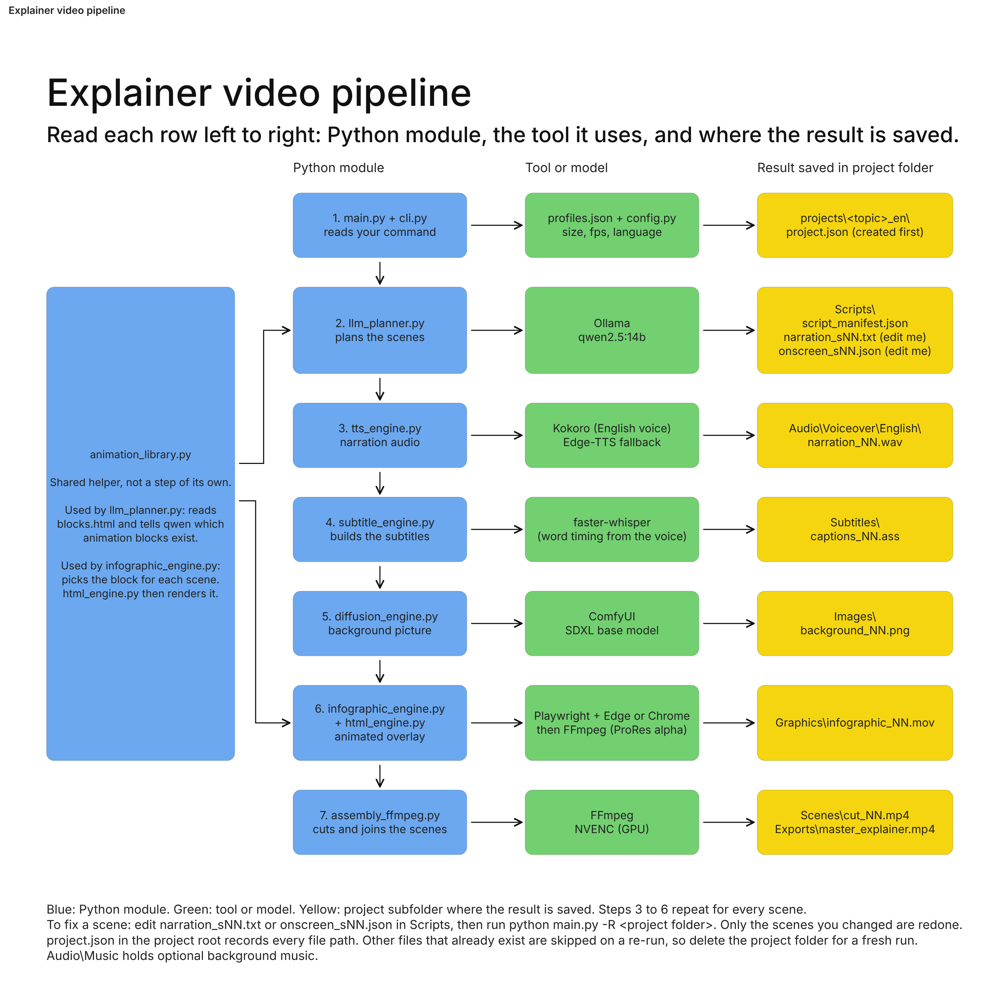

# Explainer Video Pipeline

Turn one topic into a finished explainer video, on your own computer, using free and open-source tools. You type a topic; the pipeline plans the scenes, records the narration, adds subtitles, draws a background for each scene, animates the on-screen text and exports an MP4. No API keys, no per-video bills.

**Zero monthly subscriptions.** You can build this entire AI explainer video pipeline right on your PC using 100% open-source/free tools. No paid ChatGPT, Claude, or Gemini plans are needed. Just use their free tiers to brainstorm your topic and refine your prompt, then let Ollama and other tools run the whole show locally.



```
python .\main.py -t "How computers work from electricity to storage. Exactly 5 scenes." -p Video_Landscape_1080p_16x9 -l en
```

## What it does

| Step | What happens | Tool (all free) | Where the result is saved |
|---|---|---|---|
| 1. Plan scenes | A local AI model writes the narration, on-screen text and a background prompt for every scene | Ollama + `qwen2.5:14b` | `Scripts\` and `project.json` |
| 2. Voiceover | Each narration becomes a spoken audio file | Kokoro (Edge-TTS as a backup) | `Audio\Voiceover\English\narration_NN.wav` |
| 3. Subtitles | Finds when each word is spoken | faster-whisper | `Subtitles\captions_NN.ass` |
| 4. Background | Draws one picture per scene | ComfyUI + SDXL base | `Images\background_NN.png` |
| 5. Animation | Renders flow, compare, steps and stat blocks as transparent video | Playwright + HTML blocks | `Graphics\infographic_NN.mov` |
| 6. Scene clips | Combines background, animation, subtitles and voice | FFmpeg | `Scenes\cut_NN.mp4` |
| 7. Final video | Joins the clips | FFmpeg (NVENC) | `Exports\master_explainer.mp4` |

Every project lives in its own folder under `projects\`. You can edit any scene's narration or on-screen text afterwards and re-run; only the scenes you changed are rebuilt.

## What you need

- A PC with a graphics card. Tested on an NVIDIA RTX 4080 Laptop GPU (12 GB VRAM), 64 GB RAM and NVMe SSDs.
- Minimum: an NVIDIA GPU with 8 GB VRAM, 16 GB RAM and 60 GB of free SSD space. Better: 12 GB or more VRAM, 32 GB RAM and 100 GB of free NVMe.
- An NVIDIA card is needed for two things: ComfyUI draws the backgrounds with SDXL, and FFmpeg uses the NVIDIA encoder (`h264_nvenc`) to render fast. Everything else also runs on the CPU, only slower.
- The instructions below are for **Windows 10/11** (PowerShell), which is what I use and tested. Notes for macOS and Linux are near the end.

## Install (Windows)

Run every command in Windows PowerShell. Replace `C:\` with wherever you keep the project.

### 1. Python 3.12

Everything runs on Python. Use 3.12 (I used 3.12.10).

```powershell
winget install -e --id Python.Python.3.12
python --version
```

### 2. Download ComfyUI Portable

ComfyUI draws the backgrounds. Download ComfyUI Portable for Windows: a standalone package with embedded Python and CUDA builds for NVIDIA GPUs.

https://docs.comfy.org/installation/comfyui_portable_windows

### 3. Install Ollama

Ollama runs the AI planner model on your computer.

```powershell
irm https://ollama.com/install.ps1 | iex
```

### 4. Get the code and create a virtual environment

A virtual environment is a private copy of Python for this project, so nothing you install can break your other programs.

```powershell
git clone https://github.com/mjm94219/explainer_pipeline.git
cd explainer_pipeline
python -m venv venv
.\venv\Scripts\Activate.ps1
```

You should see `(venv)` at the start of the prompt. If activation is blocked on your machine, skip it and put `.\venv\Scripts\python.exe` in front of every command below instead of `python`.

### 5. Always use `python -m pip`

pip is Python's package installer. Windows Application Control sometimes blocks `pip.exe`, so call it through Python:

```powershell
python -m pip install --upgrade pip
```

### 6. PyTorch with CUDA

The engine that lets the voice and subtitle models use your NVIDIA GPU. It is a few GB, so give it a few minutes.

```powershell
python -m pip install torch==2.6.0 torchaudio==2.6.0 --index-url https://download.pytorch.org/whl/cu124
python -c "import torch; print(torch.cuda.is_available())"
```

The second command should print `True`.

### 7. Kokoro, the English voice

Turns each scene's narration into speech, free, on your PC.

```powershell
python -m pip install kokoro-onnx soundfile
curl.exe -L -o kokoro-v1.0.onnx https://github.com/thewh1teagle/kokoro-onnx/releases/download/model-files-v1.0/kokoro-v1.0.onnx
curl.exe -L -o voices-v1.0.bin https://github.com/thewh1teagle/kokoro-onnx/releases/download/model-files-v1.0/voices-v1.0.bin
```

The two model files come from the kokoro-onnx GitHub releases page. They must sit in the project root, next to `tts_engine.py` (they are too large for this repository, so they are not included).

### 8. Edge-TTS, the backup voice

Uses Microsoft's free online voices if Kokoro fails. It needs an internet connection.

```powershell
python -m pip install edge-tts
```

### 9. faster-whisper, subtitle timing

Listens to each voiceover and finds when every word is spoken, so the subtitles stay in sync. The speech model downloads the first time it runs.

```powershell
python -m pip install faster-whisper
```

If GPU mode fails, check the faster-whisper README for the NVIDIA libraries it needs, or let it run on the CPU.

### 10. Playwright, the animations

Opens a hidden browser and renders each animation frame by frame as a transparent video. It uses the Edge or Chrome you already have.

```powershell
python -m pip install playwright
```

If you have neither Edge nor Chrome, also run `python -m playwright install chromium`.

### 11. FFmpeg, the final video

Combines everything into one clip per scene, then joins them.

```powershell
winget install Gyan.FFmpeg
```

Open a new PowerShell window so FFmpeg is on your PATH, then check it, and confirm `h264_nvenc` is listed:

```powershell
ffmpeg -version
ffmpeg -encoders | findstr nvenc
```

### 12. Pull the planner model

Ollama is already installed, so download the model (about 9 GB). If your graphics card is small, choose a smaller model such as `qwen2.5:7b` and set `LLM_MODEL` in `config.py` to match.

```powershell
ollama pull qwen2.5:14b
```

### 13. Set up ComfyUI

Unzip the portable ComfyUI you downloaded earlier (7-Zip works). Then download the SDXL base checkpoint, `sd_xl_base_1.0.safetensors`, into `ComfyUI\models\checkpoints`.

Make sure you have a free account at [huggingface.co](https://huggingface.co/) and have generated an access token. Set the token in PowerShell before you download (the SDXL base model is public, so the download may also work without it). Then, in PowerShell:

```powershell
# Go to your checkpoints folder (adjust the path if needed)
cd ComfyUI\models\checkpoints

# Set your Hugging Face token
$h = @{ Authorization = "Bearer <your Hugging Face token>" }

# Download the model file
Invoke-WebRequest -Headers $h -Uri "https://huggingface.co/stabilityai/stable-diffusion-xl-base-1.0/resolve/main/sd_xl_base_1.0.safetensors" -OutFile "sd_xl_base_1.0.safetensors"

# Back to the ComfyUI folder, then start it
cd ..\..
.\run_nvidia_gpu.bat
```

Keep the ComfyUI window open whenever you render. It serves its UI at http://127.0.0.1:8188.

### 14. Check everything

```powershell
python .\preflight_check.py
```

This reads your setup and tells you what is missing: the Python packages, the GPU, FFmpeg, the Kokoro files, and whether Ollama and ComfyUI are running with the right model and checkpoint. Nothing is changed. Fix every line marked `PROBLEM` before your first render.

## Run it

Start ComfyUI first (step 13) and make sure Ollama is running. Then, from the project folder:

**Make a new video from scratch**

```powershell
python .\main.py -t "How computers work from electricity to storage. Exactly 5 scenes.
Scene 1: electricity from the wall outlet to laptop computer which goes through the power supply to the CPU (use power_flow).
Image: a white electrical wall outlet with a power cord plugged in, the cord running to a laptop on a wooden desk, soft light, shallow depth of field
Scene 2: the CPU turns electricity into 1s and 0s (use bit_stream).
Scene 3: how an SSD stores bits as electrons (use flash_cells).
Scene 4: how a hard drive stores bits as magnets (use magnetic_platter).
Scene 5: SSD versus hard drive (use flow_cards)." -p Video_Landscape_1080p_16x9 -l en
```

If the -t (topic) says "Exactly 5 scenes.", the planner follows that scene count; otherwise it picks 4 to 6. You can give a scene its own background with a line like `Scene 2 Image: a laptop on a desk` in the topic, and name an animation for a scene (flow, compare, steps, stat, bits, cells, ring).

**Resume or rebuild an existing project**

```powershell
python .\main.py -R projects\<project folder name>
```

**Choose a video format with `-p`**

| Profile | Shape | Size | FPS |
|---|---|---|---|
| `Video_Landscape_1080p_16x9` | 16:9 landscape | 1080p | 30 |
| `Video_Landscape_720p_16x9` | 16:9 landscape | 720p | 30 |
| `Video_Landscape_4K_16x9` | 16:9 landscape | 4K | 30 |
| `Video_Portrait_1080p_9x16` | 9:16 portrait (Shorts, Reels) | 1080p | 60 |
| `Video_Square_1080p_1x1` | square | 1080p | 30 |

Profiles live in `profiles.json`; add your own there, or run `python .\main.py --manage-profiles`.

## Where everything is saved

```
<Project Root>/                  projects\<topic name>_en
├── project.json                 the saved state of the whole project
├── Audio/
│   ├── Voiceover/
│   │   └── English/             narration_NN.wav
│   ├── Music/
│   └── SoundEffects/
├── Images/                      background_NN.png
├── Graphics/                    infographic_NN.mov
├── Exports/                     master_explainer.mp4  <- your finished video
├── Subtitles/                   captions_NN.ass
├── Scripts/                     narration_sNN.txt, onscreen_sNN.json, script_manifest.json
└── Scenes/                      cut_NN.mp4 and rough.mp4
```

## Fine-tune and re-run

1. Edit `<Project Root>\Scripts\narration_sNN.txt` to change what the voice says.
2. Edit `<Project Root>\Scripts\onscreen_sNN.json` to change the animation, heading and on-screen text.
3. Re-run with `python .\main.py -R projects\<project folder name>`.

Only the scenes you changed are rebuilt. To change the subtitle size, edit `SUBTITLE_FONT_SCALE` in `config.py` and delete the files in `Subtitles\`.

## The code

| File | What it does |
|---|---|
| `main.py` | The conductor. Runs every step in order, skips anything already finished, rebuilds only what changed |
| `cli.py` | Reads your command: topic, profile, resume flag; manages `profiles.json` |
| `llm_planner.py` | Asks Ollama to plan the scenes and pick an animation for each one |
| `tts_engine.py` | Makes the voice with Kokoro, falls back to Edge-TTS |
| `subtitle_engine.py` | Times the subtitles from the voice with faster-whisper |
| `diffusion_engine.py` | Sends the background prompt to ComfyUI; makes a plain dark background if ComfyUI is not ready |
| `animation_library.py` | Reads `blocks.html` and matches each scene to one of its animations |
| `blocks.html` | One web page holding every animation as a block (flow, compare, steps, stat, bits, cells, ring) |
| `html_engine.py` | Opens the blocks page in a browser with Playwright and saves a transparent video |
| `infographic_engine.py` | Runs the animation step for each scene |
| `assembly_ffmpeg.py` | Builds one clip per scene, joins them and exports the final video |
| `config.py` | Shared settings: Ollama model, ComfyUI address, image model, voice and speed, subtitle size, project folder |
| `profiles.json` | Video formats: aspect ratio, resolution, frame rate |
| `preflight_check.py` | Checks your setup before a long render |

To add a new look, add one block to `blocks.html`; no Python changes are needed. See `blocks_README.md`.

## Settings you may want to change (`config.py`)

| Setting | What it does |
|---|---|
| `LLM_MODEL` | Ollama model used for planning (default `qwen2.5:14b`) |
| `IMAGE_MODEL` | `sdxl_base` (best quality) or `lightning` (fast, less detail) |
| `EN_TTS_VOICE`, `EN_TTS_SPEED` | Kokoro voice and speed (default `am_adam`, `1.0`) |
| `WHISPER_MODEL_SIZE` | faster-whisper model size (default `base`) |
| `SUBTITLE_FONT_SCALE` | Subtitle size as a fraction of video height (default `0.055`) |
| `PROJECTS_BASE_DIR` | Where project folders are created (default `projects\`) |

## macOS and Linux

I developed and tested this on Windows. The steps are the same elsewhere; only these commands change. I have not tested them on macOS or Linux.

- **Python 3.12:** macOS `brew install python@3.12`. Ubuntu/Debian `sudo apt install python3.12 python3.12-venv` (on an older Ubuntu, add the deadsnakes PPA first).
- **Virtual environment:** `python3.12 -m venv venv`, then `source venv/bin/activate`.
- **PyTorch:** Linux with an NVIDIA GPU uses the same CUDA command as Windows. On a Mac there is no CUDA: `python -m pip install torch torchaudio`.
- **FFmpeg:** macOS `brew install ffmpeg`; Linux `sudo apt install ffmpeg`.
- **Ollama:** macOS `brew install ollama` (or download from ollama.com); Linux `curl -fsSL https://ollama.com/install.sh | sh`.
- **ComfyUI:** there is no portable package. Run `git clone https://github.com/comfyanonymous/ComfyUI`, then `python -m pip install -r requirements.txt` inside that folder, and start it with `python main.py`.
- **Without an NVIDIA GPU:** the final video step asks FFmpeg for `h264_nvenc`. Change it to `libx264` in `assembly_ffmpeg.py`.
- Use `curl -L -o ...` instead of `curl.exe` when downloading the Kokoro files, and `/` instead of `\` in paths.

## Troubleshooting

- **`pip.exe` is blocked or `pip` is not found:** always run `python -m pip install ...`.
- **`torch.cuda.is_available()` prints `False`:** you installed the CPU build of PyTorch. Reinstall with the CUDA command in step 6.
- **"kokoro-v1.0.onnx not found":** the two Kokoro files must be in the project root, next to `tts_engine.py`.
- **Nothing happens at the background step:** ComfyUI is not running, or the SDXL checkpoint is not in `ComfyUI\models\checkpoints`. Start `run_nvidia_gpu.bat` and run `preflight_check.py`.
- **Ollama errors:** make sure Ollama is running and that `ollama pull qwen2.5:14b` finished.
- **Subtitles too small or too big:** change `SUBTITLE_FONT_SCALE` in `config.py` and delete the files in `Subtitles\`.
- **Voice sounds cut off or wrong:** delete that scene's `.wav` and `.ass` files and run again with `-R`.

## Licences and credits

This pipeline only drives other people's tools and models. Each has its own licence, so check them before you monetize a video: Ollama and the `qwen2.5` model, Kokoro, faster-whisper, ComfyUI, Stable Diffusion XL (its model licence), Playwright, FFmpeg and PyTorch.
